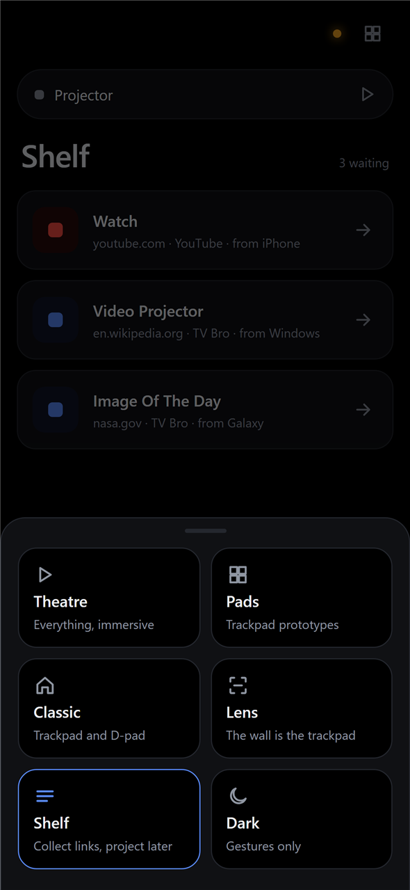
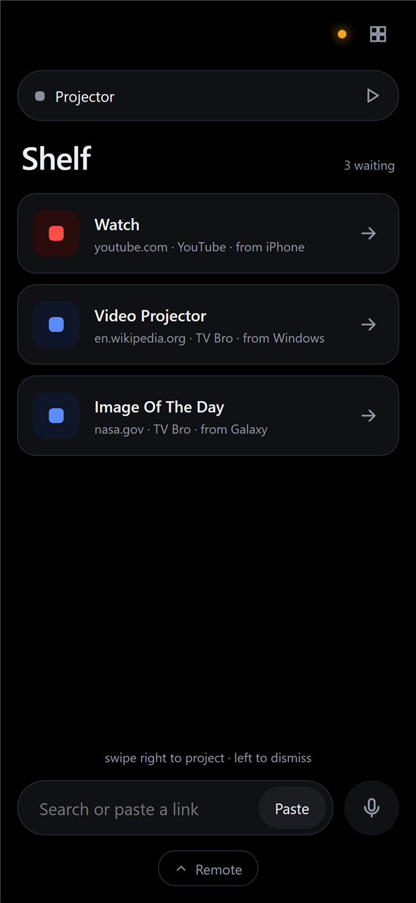
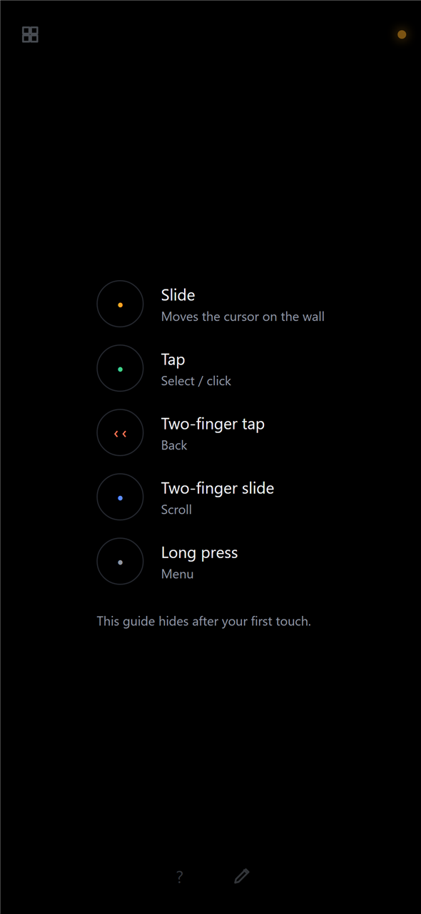

# Projector Remote

<p align="center">
  
  
  
</p>

A phone remote for an Android TV projector (built for the XGIMI Halo). It adds things the stock remote can't do:

- a trackpad that drives a mouse cursor on the wall
- a live, touchable picture of what's on the wall
- live drawing over any app
- a Shelf of links you send from your phone, PC or browser and put on the wall later
- typing that appears only when a field on the wall needs it

## How it fits together

Phones never talk to the projector directly. A small server (the relay) runs on a home server, holds one adb connection to the projector and starts helpers there only while they're needed: the projector has 1.7 GB of memory, and Android kills apps when it runs short.

```
iPhone / Galaxy / browser  ──Wi-Fi (http :8790)──────▶  relay in Docker on the        ──adb over Wi-Fi──▶  projector
       web app (React)     ──Tailscale (https, optional)▶  home server (Kotlin/Ktor)                          input helper (scrcpy, keys/touch/mouse)
       Shortcut / share sheet / extension                                                                     video helper (scrcpy, H.264, on demand)
                                                                                                              Projector Ink overlay app (on demand)
```
[docs/diagrams/system-architecture.svg](docs/diagrams/system-architecture.svg) shows every device and process.

## Layout

| Path | What it is |
| --- | --- |
| `src/main/kotlin/remote/` | The relay: command dispatch (`Relay`), app workarounds (`AppQuirks`), incoming links (`ShareRoutes`), the scrcpy input and video helpers (`InputServer`, `ScreenStream`, `ScrcpyServer`), the drawing overlay (`InkOverlay`), projector state polling (`ProjectorMonitor`, `StateParser`), the Shelf (`ShelfStore`), and Claude: its MCP tools (`Mcp`, `AgentTools`, `Locator`), whether it is in control (`Agent`) and spoken requests (`ClaudeRunner`) |
| `remote-web/` | The phone app (Vite, React, TypeScript). Six layouts: Theatre (default), Dark, Lens, Classic, Pads and Shelf, built from shared pieces in `src/shared` and `src/pads` |
| `overlay-app/` | Projector Ink: a tiny Android app that draws strokes over whatever is on screen, and Claude's glow and cursor while it's in control |
| `browser-extension/` | Send to Projector, for Edge and Chrome: a toolbar button and right-click item |
| `docs/` | Setup guide and diagrams |

## Run it on a home server

Built for a Raspberry Pi 5 with Docker, but any Linux machine with Docker on the same network as the projector works.

1. Switch on network debugging on the projector, and give the server and the projector fixed addresses in your router. Your user on the server needs to be in the `docker` group (`sudo usermod -aG docker $USER`, then log in again).
2. On the server:

   ```sh
   git clone https://github.com/Arboghast/projector-remote.git && cd projector-remote
   cp .env.example .env    # set PROJECTOR_ADB to the projector's address
   ./deploy.sh
   ```

3. The first time the server connects, the projector asks to **allow USB debugging**. Tick "always allow" and accept. The approval is kept in `data/adb`, so rebuilds don't ask again.
4. Open `http://<server-ip>:8790` on a phone on the same Wi-Fi.

**To update** after pushing changes, run `./deploy.sh` on the server. It pulls, rebuilds and restarts.

**Tailscale (optional).** Uncomment `COMPOSE_PROFILES` in `.env` and run `./deploy.sh`. The first time, `docker compose logs tailscale` prints a login link; open it and approve the device. The login is kept in `data/tailscale`. A second container joins your tailnet as `projector` and serves the remote at `https://projector.<tailnet>.ts.net`. Use that address away from home, and for anything phones only allow on https: voice typing, keeping the screen awake, and installing the remote as an app (which the Galaxy share sheet needs).

**Claude.** Say what you want from the remote ("put on the latest Veritasium video", "go to the conclusion of this article") and Claude does it on the projector while you watch. The wall glows orange while Claude is in control, a cursor shows what it's about to press, and the phone shows each step and a Stop button. It runs Claude Code inside the relay's container with the server's own login:

1. `./deploy.sh`. The image includes Claude Code.
2. Sign it in once: `docker compose exec remote claude`, then follow the login link. Or run `claude setup-token` on any computer and put the token in `.env` as `CLAUDE_CODE_OAUTH_TOKEN`. The login is kept in `data/claude-home`, apart from any Claude Code you use on the server itself, so the two never sign each other out.

Each request uses your Claude plan. Until Claude is signed in, requests fail with Claude's own message on the phone.

Claude gets the projector's tools (an MCP server the relay serves at `/mcp`) and a root shell in the container with adb, for anything the tools can't do. Its working folder isn't a jail. Every request and every shell command it runs goes in the relay's log (`docker compose logs remote`). Only the remote's own page can open its socket, so other web pages can't send requests. You can connect another Claude to the same tools with `claude mcp add --transport http projector http://<server-ip>:8790/mcp`. Like the rest of the remote, `/mcp` has no login: anyone on your Wi-Fi or tailnet can use it.

Each device's share setup (iPhone Shortcut, Galaxy, Windows extension) is in [docs/guides/send-to-projector-setup.md](docs/guides/send-to-projector-setup.md).

## Develop on a PC

You need JDK 21, Node 22 and adb. Download `scrcpy-server-v5.0.1` from the [scrcpy 5.0.1 release](https://github.com/Genymobile/scrcpy/releases/tag/v5.0.1) into `tools/`.

```powershell
cd remote-web; npm install; npm run build; cd ..
.\gradlew.bat installDist
$env:ADB = "C:\path\to\adb.exe"
.\build\install\projector-remote\bin\projector-remote.bat
```

Then open `http://127.0.0.1:8790`. For live reloading of the phone app, also run `npm run dev` in `remote-web`.

The drawing overlay ships prebuilt as `tools/ink-overlay.apk`. To rebuild it, install the Android command-line tools, `platforms;android-30` and `build-tools;34.0.0` into `tools/android-sdk`, then run `overlay-app/build.ps1`.
### Settings

The relay reads these environment variables. On the server, `PROJECTOR_ADB` and `PORT` go in `.env`.

| Variable | Default | Meaning |
| --- | --- | --- |
| `ADB` | `adb` | Path to adb |
| `PROJECTOR_ADB` | `192.168.1.5:5555` | The projector's adb address |
| `HOST` / `PORT` | `127.0.0.1` / `8790` | Where the relay listens (the Docker image uses `0.0.0.0`) |
| `PROJECTOR_BROWSER` | `com.phlox.tvwebbrowser` | Browser for ordinary links (empty = let Android choose) |
| `WEB_DIR` | `remote-web/dist` | The built phone app |
| `SHELF_FILE` | `shelf.json` | Where saved links are kept |
| `SCRCPY_SERVER` | `tools/scrcpy-server-v5.0.1` | scrcpy server jar |
| `INK_OVERLAY_APK` | `tools/ink-overlay.apk` | The drawing overlay app |
| `CLAUDE_BIN` | `claude` | Claude Code, for spoken requests |
| `CLAUDE_DIR` | `claude-work` | Claude's working folder (the Docker image uses `/data/claude`) |
| `CLAUDE_MODEL` | Claude Code's default | Model for spoken requests |
| `CLAUDE_CODE_OAUTH_TOKEN` | none | A token from `claude setup-token`, instead of signing in inside the container |

The browser extension reads the server's addresses from `browser-extension/config.js` (Wi-Fi first, then Tailscale); copy `config.example.js` to make it.

## Tests

`.\gradlew.bat test` runs the relay's tests: state parsing, shell commands, focus scrolling and share handling.
